<div align="center">

  <!-- Aesthetic Header Banner -->
  

  <!-- Dynamic Typing SVG -->
  <a href="https://alkahfi.my.id">
    
  </a>

  <p align="center">
    <strong>📍 Bandung, Indonesia</strong> &nbsp;&bull;&nbsp; 
    <strong>🌐 <a href="https://alkahfi.my.id" target="_blank">alkahfi.my.id</a></strong> &nbsp;&bull;&nbsp;
    <strong>👨‍💻 he/him</strong>
  </p>

  <!-- Profile Views Counter -->
  <p align="center">
    
  </p>

</div>

---

### 💫 About Me

```javascript
const alKahfi = {
  pronouns: "he/him",
  location: "Bandung, Indonesia",
  role: "Web Architecture & Software Developer",
  currentFocus: ["Responsive Web Apps", "Go Services", "IoT & Network Analysis"],
  portfolio: "https://alkahfi.my.id",
  hobbies: ["Coding 💻", "Exploring Tech 🔍", "Coffee ☕"]
};
```

- 🔭 Building clean, responsive web architecture with **HTML, Tailwind CSS, & JavaScript**.
- ⚙️ Exploring backend engineering with **Go (Golang)** and **IoT management**.
- 🚀 Passionate about performance, clean code, and intuitive user experiences.
- 💬 Ask me about **Frontend Architecture, Responsive Design, or Web Performance**.
- 📫 Reach out to me: **[alkahfi.my.id](https://alkahfi.my.id)** or **[fahrialkahfiiii@gmail.com](mailto:fahrialkahfiiii@gmail.com)**

---

### 🌐 Socials & Connect

<p align="left">
  <a href="https://alkahfi.my.id" target="_blank">
    
  </a>
  <a href="https://github.com/Kafiii0" target="_blank">
    
  </a>
  <a href="https://discord.com" target="_blank">
    
  </a>
  <a href="mailto:fahrialkahfiiii@gmail.com" target="_blank">
    
  </a>
  <a href="https://instagram.com" target="_blank">
    
  </a>
  <a href="https://linkedin.com" target="_blank">
    
  </a>
</p>


---

### 💻 Tech Stack & Tools

#### 🚀 Languages & Frameworks
<p align="left">
  <a href="https://skillicons.dev">
    
  </a>
</p>

#### 🗄️ Backend & Databases
<p align="left">
  <a href="https://skillicons.dev">
    
  </a>
</p>

#### 🛠️ Tools & Environments
<p align="left">
  <a href="https://skillicons.dev">
    
  </a>
</p>

---

### ✨ Badges & Achievements

<div align="center">
  
</div>

---

### 📊 GitHub Stats

<div align="center">
  <p align="center">
    <!-- GitHub Stats Card -->
    
    <!-- Most Used Languages Card -->
    
  </p>

  <p align="center">
    <!-- GitHub Streak Stats -->
    
  </p>
</div>

---

### 🐍 Contribution Activity (Snake Game)

<div align="center">
  
</div>


